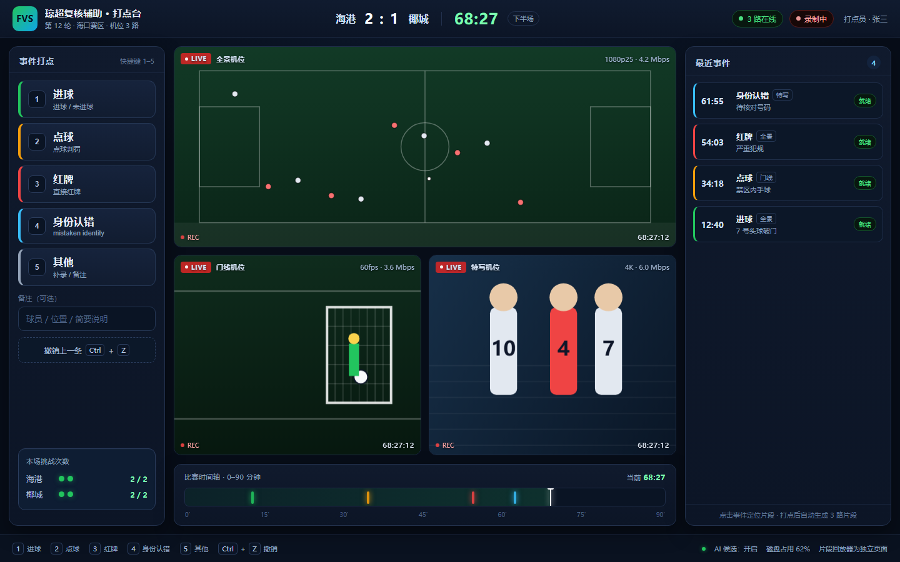

# 琼超 FVS 复核辅助系统

面向足球 FVS（Football Video Support）复核场景的轻量级辅助系统。目标是把"找片段、回看、截取、留证"从人工操作变成一条流水线，降低每场比赛的复核工时。

仅覆盖 IFAB/FVS 允许复核的 4 类事件：

- 进球 / 未进球
- 点球判罚
- 直接红牌
- 身份认错（mistaken identity）

> 越位线、球员轨迹、跑动数据、xG、自动判罚均**不在范围内**。AI 只提供候选提示，最终判罚由裁判做出。

## 截图



## 当前进度

| 模块 | 状态 |
|---|---|
| 需求规格说明书 v1.0 | 已完成（草案，待评审） |
| 实施计划（功能/技术栈/日期） | 已完成 |
| 打点台页面原型 | 已完成（单文件，可交互） |
| 多机位回看器原型 | 待开发 |
| 后端 / 流媒体接入 | 待开发 |

原型中的比分、时间、画面均为模拟数据，仅用于交互与布局验证。

## 系统构成

```
6 路固定机位 ──RTSP/RTMP──▶ MediaMTX ──▶ FFmpeg 分段录制（-c copy，10 分钟/段）
                                  │
                                  ├──▶ HLS / WebRTC 低延迟预览
                                  └──▶ 打点台（浏览器）──▶ 自动切片 ──▶ 证据包导出
```

- **流媒体**：MediaMTX，RTSP/RTMP/SRT 接入
- **录制与切片**：FFmpeg，按关键帧切割，不转码
- **后端**：Go（chi + sqlc + SQLite）
- **前端**：Vue 3 + Vite + TypeScript，构建产物嵌入二进制
- **AI 提示（可选）**：抽帧后调用 Qwen-VL 生成候选事件，不参与判罚
- **部署**：全部运行在现场主机，断网可用

## 目录结构

```
.
├── README.md
├── docs/
│   ├── SRS-v1.0.md          # 需求规格说明书
│   └── 实施计划.md           # 功能清单、技术栈、13 周排期
├── prototype/
│   └── index.html           # 打点台高保真原型（单文件，无外部依赖）
└── screenshots/
    └── marking-console-1440.png
```

## 快速预览

直接双击 `prototype/index.html`，或用任意静态服务器：

```bash
cd prototype
python -m http.server 8000
# 打开 http://localhost:8000
```

快捷键：

| 按键 | 操作 |
|---|---|
| `1` | 进球 |
| `2` | 点球 |
| `3` | 直接红牌 |
| `4` | 身份认错 |
| `5` | 其他 / 补录 |
| `Ctrl + Z` | 撤销上一条打点 |

点击右侧事件卡片可定位到对应片段。

## 文档

- [需求规格说明书 v1.0](docs/SRS-v1.0.md)：角色、流程、功能需求、数据表、接口、验收标准。
- [实施计划](docs/实施计划.md)：功能清单、技术栈、13 周排期与验收节点。

## 说明

- 本仓库为方案与原型材料，尚未包含可运行的后端服务。
- 未指定开源许可证，默认保留所有权利；对外发布前请先确认授权方式。
